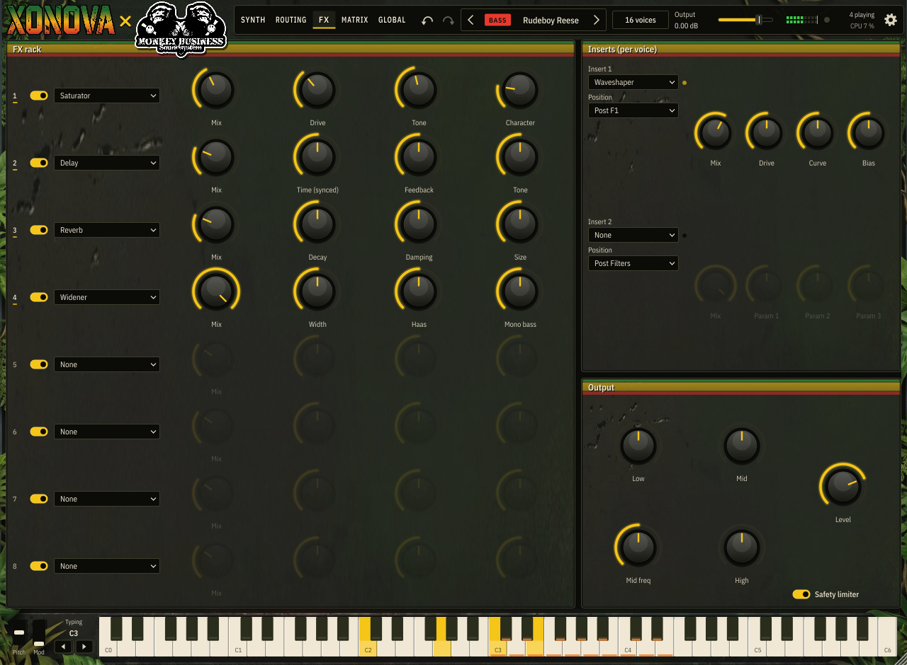

The **FX rack** processes the mixed output of all voices through up to **eight effects in series**. Any
effect type can go in any slot, and you can use the same type more than once.

## Each slot

| Control | What it does |
|---|---|
| **Number** | The processing position, 1 (first) to 8 (last). Click it for **Move up**, **Move down**, **Move to first** and **Move to last**. |
| **Power** | Bypass the slot without losing its settings. |
| **Type** | The effect, or **None**. |
| **Mix** | Dry/wet balance. Default 30 %. |
| Three parameters | Change with the type. |

You can also reorder slots by dragging them on the [Routing page](/xonova-docs/pages/routing/).

## Effects

| Effect | Param 1 | Param 2 | Param 3 | Notes |
|---|---|---|---|---|
| **Chorus** | **Rate** | **Depth** | **Spread** – stereo width | Two modulated taps per channel. Classic thickening. |
| **Flanger** | **Rate** | **Depth** | **Feedback** – negative or positive | Short modulated delay; feedback sets how jet-like it gets. |
| **Phaser** | **Rate** | **Depth** | **Feedback** | Six swept allpass stages per channel. |
| **Delay** | **Time (synced)** – 1/32 up to 1/1, in note values | **Feedback** | **Tone** – dark ↔ thin, 50 % neutral | Tempo-synced **ping-pong** delay with filtered repeats. |
| **Reverb** | **Decay** – 0.3 to 12 s | **Damping** | **Size** | Eight-line feedback-delay-network reverb with gentle modulation. |
| **Saturator** | **Drive** – 0 to 36 dB | **Tone** – dark ↔ bright | **Character** – warm/asymmetric ↔ hard/symmetric | Level-compensated, so turning up Drive doesn't just make it louder. |
| **Widener** | **Width** – 0 % mono, 50 % unchanged, 100 % double | **Haas** – 0 to 15 ms | **Mono bass** – 20 to 400 Hz | Mid/side widening with a Haas delay and a high-pass on the sides that keeps the low end mono. |
| **Dub Delay** | **Time (synced)** – 1/32 up to 1/1, in note values | **Feedback** – 0 to 120 % | **Tone** – dark ↔ thin, 50 % neutral | Tape-style echo: each side echoes itself (the **Delay** is the ping-pong one). The repeats run through a soft clipper, so feedback past 100 % self-oscillates and stays under control; time changes glide like tape. |
| **Tape** | **Drive** | **Wobble** – wow and flutter together | **Tone** – dark ↔ bright | Tape saturation with slow wow and fast flutter; at zero wobble it is just the drive. |
| **Spring** | **Decay** | **Tone** – dark ↔ bright | **Drip** – how much the spring chirps | A spring-reverb tank: the typical boingy splash on snares, stabs and dub sirens. |
| **Glue** | **Threshold** – −40 to 0 dB | **Ratio** – 1:1 to 10:1 | **Release** – 50 to 1200 ms | A bus compressor (10 ms attack) with automatic makeup gain of up to 6 dB. At 100 % mix it squeezes the whole sound; a lower mix is parallel compression. |

:::tip[Sound-system safe]
For bass patches, end the chain with a **Widener**: set **Mono bass** around 120–200 Hz so the sub stays
centred on a mono club rig while the top end stays wide.
:::

## Order matters

Effects run from slot 1 to slot 8. A few rules of thumb:

- **Saturator first**, then modulation effects, then **Delay**, then **Reverb**.
- **Reverb before Delay** gives washed-out echoes of a reverb; **Delay before Reverb** puts the echoes in
  the room.
- **Widener last**, so nothing after it undoes the mono bass.

FX parameters are modulation targets too: an LFO on the Delay **Feedback** or a macro on Reverb **Mix**
makes for live dub moves. A macro on the **Dub Delay** feedback, pushed past 100 %, gives the classic runaway echo.
