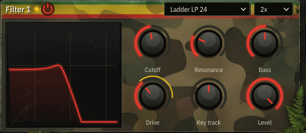

XONOVA has two filters per voice, **Filter 1** and **Filter 2**. They're identical; how the sound flows
through them is set by the [routing](/xonova-docs/filters/routing/). Filter 1 is on in a new patch.

## Controls

| Control | Range | What it does |
|---|---|---|
| **Power** | On / off | A switched-off filter passes the sound through unchanged. |
| **Type** | 12 types | See below. Switching types crossfades smoothly, even while notes play. |
| **Oversampling** | 1x, 2x, 4x | Runs the filter at a higher internal rate. Cleaner at high resonance, drive and cutoff, at the cost of CPU. 2x is the default. |
| **Cutoff** | 20 Hz – 20 kHz | The filter frequency. |
| **Resonance** | 0 – 100 % | Emphasis around the cutoff. High settings ring and squeal. |
| **Character** | 0 – 100 % | A type-dependent control; its label changes with the type (below). |
| **Drive** | 0 – 100 % | Pushes the signal into the filter for saturation and grit. |
| **Key track** | −100 – +100 % | Makes the cutoff follow the note you play. At 100 % the cutoff moves one-for-one with pitch. |
| **Level** | 0 – 100 % | The filter's output level. |

The display shows the filter's response. While notes play it's drawn at the **modulated** cutoff, so you
can see envelopes and LFOs moving it.

## Types and what Character does

| Type | Family | Character becomes | Sound |
|---|---|---|---|
| **Ladder LP 24** | Low-pass, 24 dB/oct | **Bass** | The classic fat, resonant transistor-ladder low-pass. Resonance thins the low end on real ladders; *Bass* puts it back. |
| **SVF LP 12** | Low-pass, 12 dB/oct | **Stereo** | A gentler, more open low-pass. |
| **SVF BP 12** | Band-pass | **Stereo** | Keeps a band around the cutoff. Nasal, telephone-like. |
| **SVF HP 12** | High-pass | **Stereo** | Removes the lows. |
| **SVF Notch 12** | Notch | **Stereo** | Cuts a narrow band; sweeping it phases. |
| **LP 6** | Low-pass, 6 dB/oct | **Stereo** | A very gentle tone control. |
| **HP 6** | High-pass, 6 dB/oct | **Stereo** | A gentle low cut. |
| **Comb +** | Comb | **Damping** | A tuned resonator with peaks at the harmonics. Plucked, metallic, string-like. |
| **Comb −** | Comb | **Damping** | The inverted comb: hollow, odd-harmonic resonance. |
| **Formant** | Vocal | **Vowel** | Vowel-shaped resonances. *Vowel* morphs between vowels, *Cutoff* shifts the formants. |
| **Scream BP** | Band-pass | **Bite** | An aggressive, overdriven band-pass for screaming leads and jungle hoovers. |
| **Allpass** | Phase | **Spacing** | Shifts phase without changing level on its own; with feedback or a parallel mix it creates phasing. |

**Stereo** (on the SVF and 6 dB types) spreads the cutoff between the left and right channels: at 50 %
both sides match; turning it away from the centre moves the two sides apart, up to an octave, so one side
is brighter than the other – width that moves with the filter.

### Key tracking with the combs

The comb filters are tuned by their cutoff. With **Key track at 100 %**, a comb rings at the pitch of the
note you play – the basis of plucked and Karplus-Strong-style sounds. Combs always run at the base sample
rate; their oversampling setting doesn't apply.

## Modulating the filters

Cutoff is the classic target: an envelope for plucks and stabs, an LFO for wobbles, velocity or a macro for
expression. For audio-rate filter FM use the [mod oscillator](/xonova-docs/sound/mod-oscillator/#filter-fm).

:::tip[Getting a 'wobble']
LFO 1 → Filter 1 Cutoff, **Tempo sync** on, Sync rate `1/8` or `1/4T`. Put the LFO rate on a macro to change
the wobble speed live.
:::
