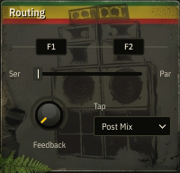

Three things decide how sound travels through the filters:

1. each source's **Filter** balance (F1 ↔ F2),
2. the **serial/parallel** blend between the filters,
3. the **feedback** path back into Filter 1.

All three are in the **Routing** panel on the Synth page, and you can edit them visually on the
[Routing page](/xonova-docs/pages/routing/).



## Source balance

Every source – Osc 1, Osc 2, Osc 3 and Noise – has a **Filter** slider from **F1** to **F2**. All the way to
F1 feeds only Filter 1, all the way to F2 only Filter 2, and in between feeds both. This means you can, for
example, send the sub oscillator straight to a clean low-pass while the top oscillators go through a
screaming band-pass.

## Serial / parallel

The **Ser – Par** slider blends between two layouts:

- **Serial** (left): Filter 1's output feeds Filter 2. Both filters shape the same sound one after the
  other. Sources sent to F2 join in at Filter 2's input.
- **Parallel** (right): the filters run side by side, and their outputs are mixed.

In between, Filter 1's output is split: part goes on through Filter 2, part straight to the output.

```
F1 in  = sources sent to F1 + feedback
F2 in  = sources sent to F2 + (serial amount × F1 out)
output = F2 out + (parallel amount × F1 out)
```

:::note
If Filter 2 is switched off it passes sound through unchanged. So in **serial** with only Filter 1 on, you
hear Filter 1 alone – the default setup.
:::

## Feedback

**Feedback** sends the filtered signal back into Filter 1's input, one sample later. It's DC-blocked and
softly clipped, so it saturates rather than blowing up. Small amounts thicken and add harmonics; larger
amounts make the filters scream and self-oscillate.

**Tap** chooses where the feedback is taken from:

| Tap | Feedback taken from |
|---|---|
| **Post F1** | Filter 1's output only |
| **Post Mix** | The final mix of both filters (default) |

An insert placed **Post Filters** sits *inside* the feedback loop, so a waveshaper or frequency shifter there
also shapes what's fed back. See [Inserts](/xonova-docs/effects/inserts/).
