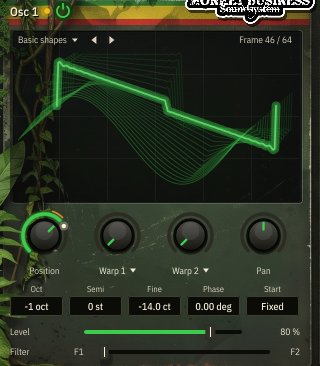
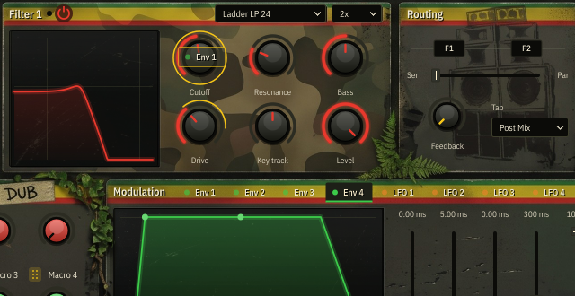

This walkthrough builds a classic jungle **reese bass** from scratch. Along the way you'll use the
oscillators, unison, a filter, an envelope, an LFO and a macro – the core of how XONOVA works. Have a MIDI
keyboard ready, or use the on-screen keys or your computer keyboard (the <kbd>A</kbd> row plays white
keys).

## 1. Start from Init

Click the **preset name** in the header to open the preset browser and click **Init**. You now hear a plain
sound: Osc 1 on, playing the *Basic shapes* table, through Filter 1 (wide open) and the amp envelope.

:::tip
Every step you take is undoable. <kbd>Ctrl</kbd>+<kbd>Z</kbd> (<kbd>Cmd</kbd>+<kbd>Z</kbd> on macOS) goes
back, the arrows in the header do the same.
:::

## 2. Pick a wavetable

On **Osc 1**, click the table name at the top left of the display (it reads *Basic shapes*) and choose
**Analog → Warm saw**. Set **Oct** to `-1 oct`: middle-click the value field and type `-1`.

Turn **Position** slowly. The display shows the frames of the table; *Warm saw* opens from dark to bright
as you move through it. Leave it around a third of the way.

## 3. Add a second, detuned oscillator

Click the **power button** next to **Osc 2** to turn it on, and give it the same table (*Warm saw*) and
`-1 oct`. Set its **Fine** to `+12 ct` (middle-click and type `12`).

The two saws now beat against each other: that slow phasing is the heart of a reese.

## 4. Thicken it with unison

Open the **Global** page and, under **Unison (all oscillators)**, set **Unison voices** to `3`. Keep
**Detune** low (around 10 %) and push **Stereo** to the right. Go back to the **Synth** page.

:::caution
Unison multiplies the CPU load: each voice now plays three copies of every oscillator. Watch the CPU figure
in the header.
:::

## 5. Darken it with the filter

On **Filter 1**, keep **Ladder LP 24** and pull **Cutoff** down to around 400 Hz. Add a little
**Resonance** and some **Drive** for grit.

## 6. Make the filter move: drag an envelope

This is the most important move in XONOVA. In the **Modulation** panel at the bottom, **drag the
Env 1 tab** and drop it on Filter 1's **Cutoff** knob.

The knob gets a coloured ring: that's the modulation range. **Alt-drag** the knob to set how far Env 1
opens the filter. On the envelope display, shorten **Decay** and lower **Sustain** so each note starts
bright and closes down.

## 7. Add movement with an LFO

Drag the **LFO 1** tab onto Osc 1's **Position** knob and Alt-drag a small amount. Select the LFO 1 tab to
see its settings: turn on **Tempo sync** and set **Sync rate** to `1/2` so the timbre sweeps in time with your track.

## 8. Put it on a macro

Drag the handle (the dotted grip) of **Macro 1** onto Filter 1's **Cutoff** too. Double-click the macro's
label and call it `Growl`. Now one knob opens the filter, and you can automate it from your DAW or map it
to a hardware knob with [MIDI learn](/xonova-docs/midi/midi-learn/).

## 9. Finish with effects

Open the **FX** page. Put a **Saturator** in the first slot for weight and a short **Reverb** further down
with a low mix. Keep the bass mono: a **Widener** with its *Mono bass* control keeps the low end centred.

## 10. Save it

Open the preset browser and click **Save current sound…**. Give it a name, the **Bass** category, a few tags
(`reese`, `jungle`) and your name as author. It now shows up under **Yours** in the browser.

## Where next

- [Modulation overview](/xonova-docs/modulation/overview/) – everything about routings.
- [Warp modes](/xonova-docs/sound/warp-modes/) – reshape the wave beyond the table.
- [Filters](/xonova-docs/filters/filters/) – the 12 types and what *Character* does for each.
