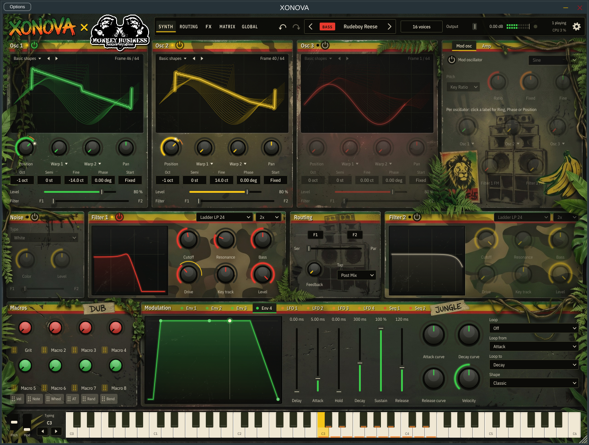

XONOVA is a polyphonic wavetable synthesizer by **Monkey Business Sound System**. It is built for
weight and movement: rolling reese basses, ragga stabs, screaming leads and evolving pads. You can drive it
from a keyboard, your DAW or the computer keyboard, and almost everything you can turn can be modulated by
dragging a source onto it.

## What's inside

Per voice:

- **Three wavetable oscillators**, each with two warp stages (phase bend, asymmetry, hard sync, spectral
  tilt, formant shift), pitch, phase, level, pan and a balance between the two filters.
- A **modulation oscillator** for ring, phase (FM-style) and wavetable-position modulation at audio rate,
  plus filter FM.
- A **noise** source: white, pink, filtered or crackle.
- **Two filters** with 12 types and up to 4x oversampling, blended from serial to parallel, with a feedback
  path.
- **Two inserts** (bitcrusher, waveshaper, frequency shifter, sine shaper, delay comb, EQ band) that you can
  place before or after the filters.
- Up to **8-voice unison** with detune, stereo spread and wavetable position spread.

After the voices:

- An **8-slot FX rack** (chorus, flanger, phaser, delay, reverb, saturator, widener) in any order.
- An **output section** with a three-band EQ, level and a safety limiter.

Modulation:

- **Four envelopes** with curves and loops, **four LFOs**, **two step sequencers** and **eight macros**.
- Per-note and controller sources: velocity, note, random, poly pressure, mod wheel, aftertouch, pitch
  bend and timbre (CC 74).
- A **64-slot modulation matrix** with response curves and scale sources.

And around it: **200 factory presets** with a full browser, **MIDI learn**, unlimited **undo/redo** and a
fully scalable interface.

## Formats and platforms

| | Linux x86_64 | Windows x64 |
|---|---|---|
| VST3 | Yes | Yes |
| CLAP | Yes | Yes |
| LV2 | Yes | – |
| Standalone app | Yes | Yes |

macOS has no download yet; see the [FAQ](/xonova-docs/help/faq/#is-there-a-mac-version).

:::note[Beta]
XONOVA is currently in **beta (0.2.0)**. Things can still change between versions, and your feedback
shapes what comes next. See [Reporting problems](/xonova-docs/help/reporting-problems/).
:::

## How this manual is organised

- **Getting started** – install XONOVA and make a first sound.
- **The interface** – the window, how controls behave, the live displays and settings.
- **Pages** – a tour of the five pages: Synth, Routing, FX, Matrix and Global.
- **Sound sources, Filters, Effects** – every section of the signal path in detail.
- **Modulation** – drag-and-drop routing, envelopes, LFOs, sequencers, macros and the matrix.
- **Wavetables, Presets, MIDI** – the factory library, your own content and hardware control.
- **Reference and Help** – shortcuts, every parameter, file locations, FAQ and troubleshooting.

## Licence

XONOVA is free to use but not open source. It is distributed **pay-what-you-want**. The licence and
third-party notices come with every download (`LICENSE.txt` and `THIRD-PARTY-NOTICES.txt`).
