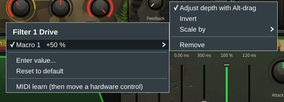

Every knob, slider, value field and switch in XONOVA behaves the same way.

## Mouse

| Action | Result |
|---|---|
| Drag | Change the value |
| <kbd>Ctrl</kbd>-drag (<kbd>Cmd</kbd> on macOS) | Fine steps |
| Mouse wheel | Change the value step by step |
| Double-click | Reset to the default |
| **Middle-click** | Type a value |
| Right-click | Context menu: **Enter value…**, modulation options, **MIDI learn** |
| Hover | Tooltip: every control has one |

## Typing values

Middle-click a knob, slider or value field (or right-click and choose **Enter value…**) and type. Units are
optional, and you can use the short forms:

| You type | You get |
|---|---|
| `2k` or `2 kHz` | 2000 Hz |
| `1.5 s` | 1500 ms |
| `80 %` or `80` | 80 % |
| `-1` on an Oct field | −1 octave |
| `12` on a Fine field | +12 cents |

Press <kbd>Enter</kbd> to accept or <kbd>Escape</kbd> to cancel.

## Keyboard focus

A control you click takes keyboard focus. The arrow keys then step it up and down.

## Menus and selectors

Labels with a small ▾ arrow (such as **Warp 1 ▾** or the table name on an oscillator) open a menu when
you click them. Drop-down boxes (filter type, oversampling, LFO shape…) work like any drop-down.

## Power buttons

Sections that can be switched off (oscillators, noise, mod oscillator, filters, FX slots) have a
**power button** next to their title. A section that's off is drawn dimmed and drops out of the sound.

## Modulated controls

A knob with modulation shows a **coloured ring** for each routing, and a bright dot shows where the value
really is while notes play. See [Modulation overview](/xonova-docs/modulation/overview/) for Alt-drag,
inverting and removing routings.

## Undo and redo

Undo and redo cover **every** edit: knob moves, routings, curves, steps, wavetables, FX order, a preset load
and moves from a hardware controller. One drag or one preset load is one step.

| | |
|---|---|
| Undo | <kbd>Ctrl</kbd>+<kbd>Z</kbd> / <kbd>Cmd</kbd>+<kbd>Z</kbd>, or the left arrow in the header |
| Redo | <kbd>Ctrl</kbd>+<kbd>Shift</kbd>+<kbd>Z</kbd>, <kbd>Ctrl</kbd>+<kbd>Y</kbd>, or the right arrow in the header |
