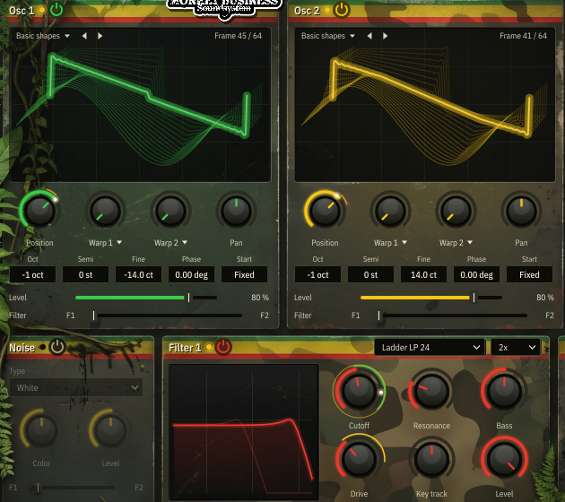

While notes play, XONOVA's displays show what the sound is **actually doing**, including modulation, not
just where the knobs are set.

| Display | What it shows |
|---|---|
| **Wavetables** | The bright frame is the one the newest note plays, including modulation. Dots mark other notes playing other frames. |
| **Envelopes and LFOs** | A playhead runs along the shape. |
| **Step sequencers** | The playing step is lit. |
| **Filters** | The response curve is drawn at the modulated cutoff. |
| **Modulated knobs** | A bright dot shows where the value really is. |
| **Section titles** | A light next to each title shows that signal is passing through. |
| **Routing page** | The signal-flow diagram lights up along the path the sound takes. |

## Turning it off

The animation costs a little CPU on the graphics side (not in the audio). If you want a calm, still
interface or your computer's graphics are slow, switch off **gear → Animated displays**. The setting is
global: it applies to every instance.
