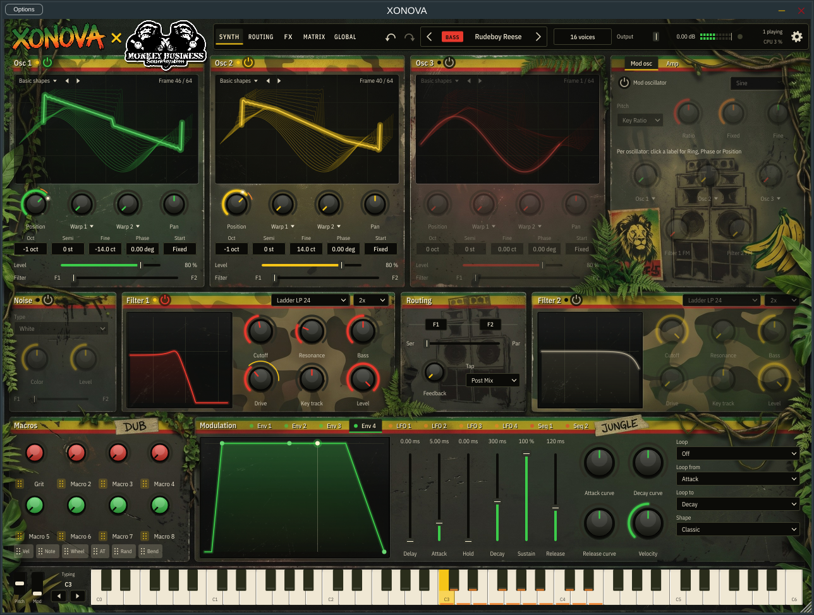
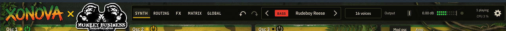
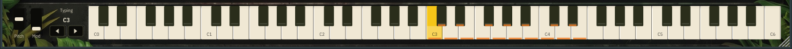

The XONOVA window has three parts: the **header** across the top, the **page** in the middle and the
**footer** keyboard at the bottom.

## Header

From left to right:

| Part | What it does |
|---|---|
| **Logo** | When an update is available, “x.y.z available” appears under it. Click it to open the release page. |
| **Page tabs** | **Synth**, **Routing**, **FX**, **Matrix** and **Global**. See [Pages](/xonova-docs/pages/synth/). |
| **Undo / Redo** | Step back and forward through every edit. See [Controls](/xonova-docs/interface/controls/#undo-and-redo). |
| **Preset bar** | The category badge and preset name. Click the name to open the [preset browser](/xonova-docs/presets/browser/); the arrows step to the previous and next preset. |
| **Polyphony** | How many notes can sound at once (1–32). Drag up or down, or middle-click to type. |
| **Output** | The master output level and meter. The dot lights up when the safety limiter is working. |
| **Playing / CPU** | The number of voices sounding right now and the CPU load. |
| **Gear** | The settings menu: interface size, animated displays, MIDI controllers, updates and folders. See [Settings](/xonova-docs/interface/settings/). |

### Reading the CPU figure

The CPU figure is the share of each audio block's real time this instance of XONOVA needs. Near 100 %
you'll hear dropouts. Unison, 4x filter oversampling and lots of voices are the biggest costs; see
[Troubleshooting](/xonova-docs/help/troubleshooting/#crackles-dropouts-or-high-cpu).

## Pages

| Page | What's on it |
|---|---|
| [Synth](/xonova-docs/pages/synth/) | Oscillators, mod oscillator, noise, both filters, routing, macros and the modulation panel. Where you spend most of your time. |
| [Routing](/xonova-docs/pages/routing/) | The whole signal flow as a live diagram you can edit by dragging. |
| [FX](/xonova-docs/pages/fx/) | The two inserts, the 8-slot FX rack and the output section. |
| [Matrix](/xonova-docs/pages/matrix/) | Every modulation routing in one list, with curves and scale sources. |
| [Global](/xonova-docs/pages/global/) | Play mode, glide, unison, pitch-bend range and the About panel. |

## Footer

- **Pitch** and **Mod** wheels. The pitch wheel springs back; the mod wheel stays where you leave it.
- **Typing** shows the octave the computer keyboard plays. The arrows move it.
- The **keyboard** plays notes. Click lower on a key to play louder. A coloured strip marks the keys your
  computer keyboard reaches.

See [Playing XONOVA](/xonova-docs/midi/playing/) for the full details.

## Resizing

Drag the bottom-right corner of the window, or choose a size under **gear → Interface size** (60 % to
200 %). Everything scales sharply. New instances open at the size you last chose, never larger than your
screen.
