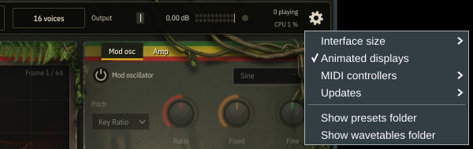

Click the **gear** at the top right of the window.

| Item | What it does |
|---|---|
| **Theme** | **Monkey Business** (the jungle look, the default) or **FirstKlaas** (neon on dark metal). Only the look changes; your sound and settings stay. |
| **Interface size** | 60 %, 75 %, 90 %, 100 %, 125 %, 150 %, 175 % or 200 %. You can also drag the window's corner. |
| **Animated displays** | Switch the [live feedback](/xonova-docs/interface/live-feedback/) on or off. |
| **MIDI controllers** | Lists every [MIDI learn](/xonova-docs/midi/midi-learn/) assignment, with **Cancel MIDI learn** while learning and **Forget all controllers**. |
| **Updates** | **Check automatically (once a day)** on or off, and **Check now**. See [Updates and privacy](/xonova-docs/reference/updates-and-privacy/). |
| **Show presets folder** | Opens your user presets folder in your file manager. |
| **Show wavetables folder** | Opens your user wavetables folder. |

:::note
Settings are **global**: they're not stored in presets or in your DAW project, and they apply to every
XONOVA instance. They live in `Settings.xml` in your [XONOVA folder](/xonova-docs/reference/files/).
:::
