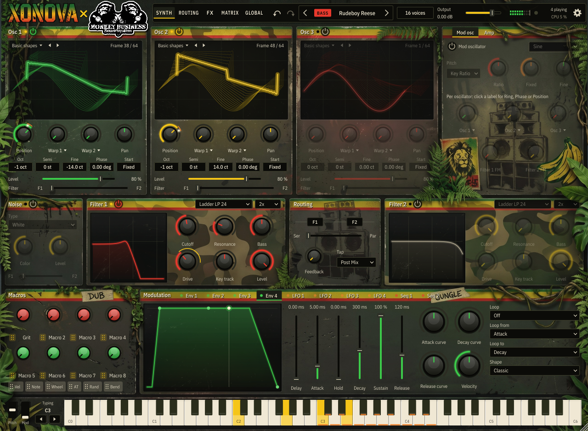
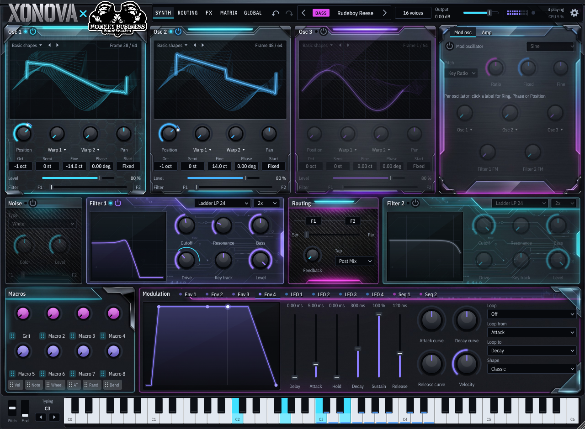
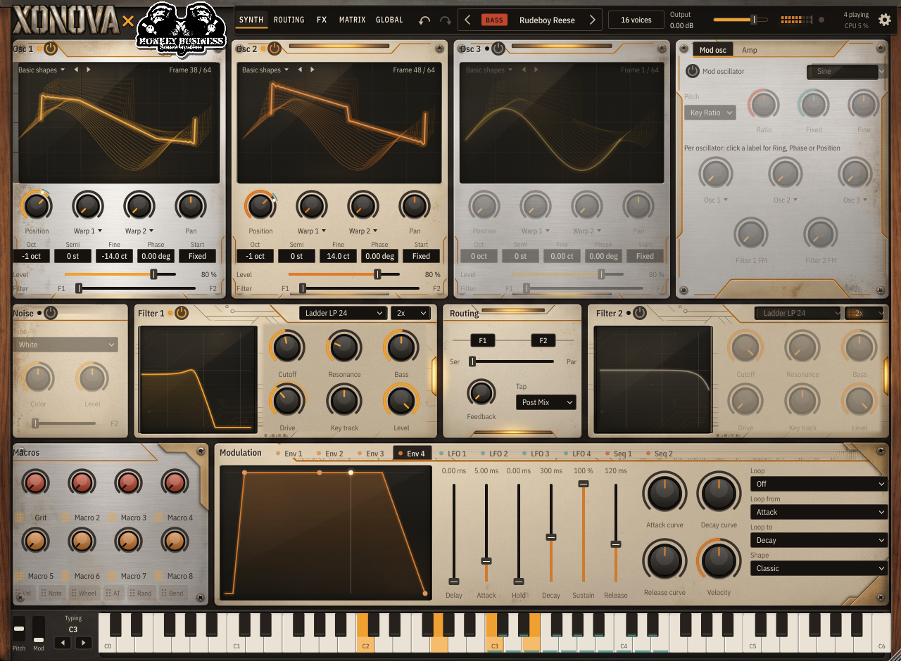
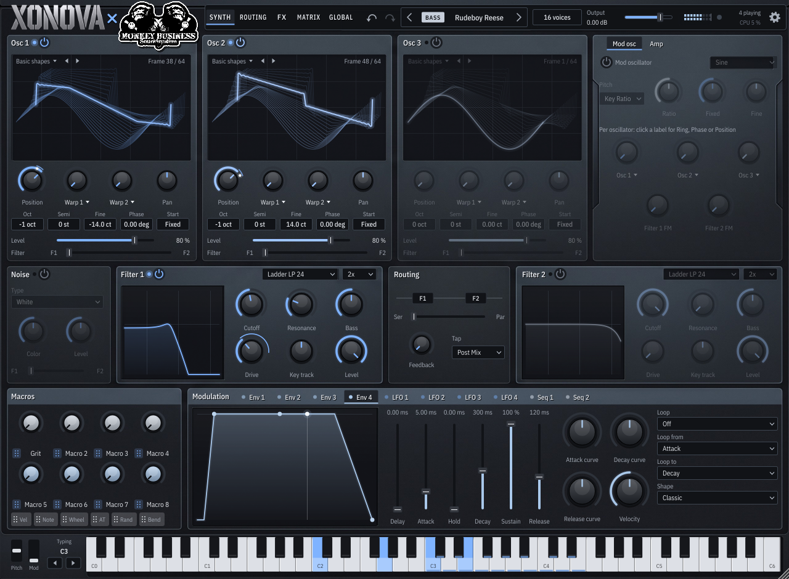

XONOVA comes in four looks. Choose one under **gear → Theme**. Only the look changes: the sound, your presets
and every setting stay as they are. The theme is a global setting, so it applies to every XONOVA instance
and is remembered next time.

## Monkey Business

The default: the jungle look of Monkey Business Soundsystem, with camo panels, rasta header stripes and the
graffiti logo.

## FirstKlaas

Neon on dark metal and carbon: cyan and purple sections with glowing edges.

## Classic Analog

Cream and brushed-metal panels in a wooden case, with amber lamps, like a vintage hardware synth. The
labels on the panels are dark; knobs, displays and menus stay dark, as on the real thing.

## Dark Minimal

Plain slate panels, greys and one cool blue accent. The calmest of the four.

