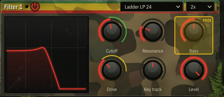

Put any XONOVA control on a knob or fader of your MIDI controller.

## Assigning a controller

1. **Right-click** a knob or slider and choose **MIDI learn (then move a hardware control)**.
2. The control is outlined and marked **MIDI** while it waits.

   

3. Move a knob or fader on your controller. The control is assigned and the outline disappears.

Press <kbd>Escape</kbd> (or **gear → MIDI controllers → Cancel MIDI learn**) to cancel.

From then on that controller (CC) moves the control on **any MIDI channel**, and your DAW can record the
moves as automation.

## Removing assignments

- **One:** right-click the control again and choose **Forget MIDI CC _n_**.
- **All:** **gear → MIDI controllers → Forget all controllers**.

**gear → MIDI controllers** also lists every current assignment (for example `CC 21: Filter 1 Cutoff`).

## How assignments are stored

- Assignments are saved as **your default**, so they come with you into every new session and instance.
- A DAW session saved **with its own** assignments uses those when you reopen it.
- **Presets never change them** – you can switch sounds and your controller layout stays the same.

They live in `MidiMappings.xml` in your [XONOVA folder](/xonova-docs/reference/files/).

## What can't be assigned

- Bank select, sustain (CC 64) and channel-mode messages are reserved.
- **CC 1 (mod wheel)** and **CC 74 (timbre)** keep their built-in roles as modulation sources even when
  assigned to a control.

:::tip
Map your controller's knobs to the **eight macros**: every preset then has its most useful moves under
your fingers, and you only have to set it up once.
:::
