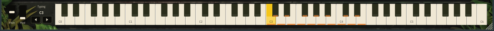

## MIDI keyboard

In a DAW, put XONOVA on an instrument track and play. In the standalone app, choose your MIDI input under
**Options → Audio/MIDI Settings…**.

XONOVA responds to:

| Message | Does |
|---|---|
| Notes and velocity | Play; velocity is a [modulation source](/xonova-docs/modulation/performance-sources/) and shapes the amp envelope |
| Pitch bend | Bends pitch by the **Bend range** (Global page, 1–24 semitones) |
| CC 1 (mod wheel) | The **Mod Wheel** source |
| CC 64 (sustain pedal) | Holds notes |
| Channel pressure | The **Aftertouch** source |
| Polyphonic pressure | The **Poly Pressure** source |
| CC 74 | The **Timbre** source |
| Other CCs | Anything you assign with [MIDI learn](/xonova-docs/midi/midi-learn/) |

With per-note pressure and CC 74, expressive controllers can shape each note through the modulation matrix.

## On-screen keyboard

- **Click or drag** across the keys. Clicking lower on a key plays louder.
- The **Pitch** wheel springs back when you let go; the **Mod** wheel stays where you leave it – just like
  hardware wheels.

## Computer keyboard

With the XONOVA window focused:

| Keys | Play |
|---|---|
| <kbd>A</kbd> <kbd>S</kbd> <kbd>D</kbd> <kbd>F</kbd> <kbd>G</kbd> <kbd>H</kbd> <kbd>J</kbd> <kbd>K</kbd> <kbd>L</kbd> <kbd>;</kbd> | White keys |
| <kbd>W</kbd> <kbd>E</kbd> <kbd>T</kbd> <kbd>Y</kbd> <kbd>U</kbd> <kbd>O</kbd> <kbd>P</kbd> | Black keys |
| <kbd>Z</kbd> / <kbd>X</kbd> | Octave down / up |

A strip on the keyboard shows which keys the typing keys reach, and **Typing** at the left shows the octave
(C3 by default). The ◂ ▸ buttons move it too.

:::note
Your DAW may keep some keys for its own shortcuts. The standalone app gets them all.
:::
