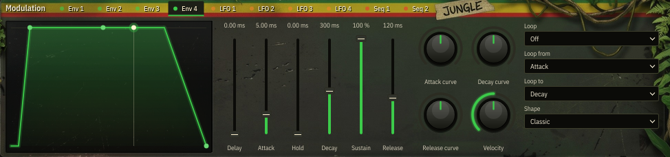

XONOVA has four envelopes, **Env 1** to **Env 4**. Each starts when a note starts and shapes something over
the life of that note. **Env 4** drives the amplifier by default.

## Stages

Each envelope has six stages, drawn left to right on the display:

| Stage | Range | What happens |
|---|---|---|
| **Delay** | 0 – 10 s | Waits before starting |
| **Attack** | 0 – 20 s | Rises from 0 to full |
| **Hold** | 0 – 10 s | Stays at full |
| **Decay** | 0 – 20 s | Falls to the sustain level |
| **Sustain** | 0 – 100 % | The level held while the key is down |
| **Release** | 0 – 20 s | Falls to 0 after the key is released |

Set them with the faders, or **drag the handles on the display**: the attack peak (attack time), the decay
corner (decay time sideways, sustain level up and down) and the release end (release time).

## Curves

**Attack curve**, **Decay curve** and **Release curve** bend each stage from linear into exponential or
logarithmic shapes. At the centre the stage is a straight line; turning the knob either way bends it, and
the display shows the result as you turn. Snappy plucks want a decay that drops fast at the start.

## Velocity

**Velocity** sets how much playing harder makes the envelope bigger. At 0 % every note gets the full
envelope; at 100 % soft notes get very little. It defaults to 50 % on Env 4 (the amp) and 0 % on the
others.

## Loops

Loops turn an envelope into a rhythmic or evolving modulator.

| Loop | Behaviour |
|---|---|
| **Off** | Plays once. |
| **Sustain Loop** | While the key is held, the stages from **Loop from** to **Loop to** repeat. Releasing the key goes to the release as usual. |
| **Free Loop** | The loop keeps running even after the key is released (there's no release stage). The envelope that drives the amp always releases, so notes still end. |

**Loop from** and **Loop to** can be Delay, Attack, Hold or Decay. A loop restarts its first stage from the
current level, so looping back to the attack never jumps.

:::tip
Loop from **Attack** to **Decay** with short times and Sustain Loop on: a pulsing, gated modulator that
follows each note – great on cutoff or wavetable position.
:::

## Custom shape

Set **Shape** to **Custom** to draw your own envelope curve instead of the classic stages.

## Live playhead

While notes play, a playhead runs along the envelope shape so you can see where each note is.
