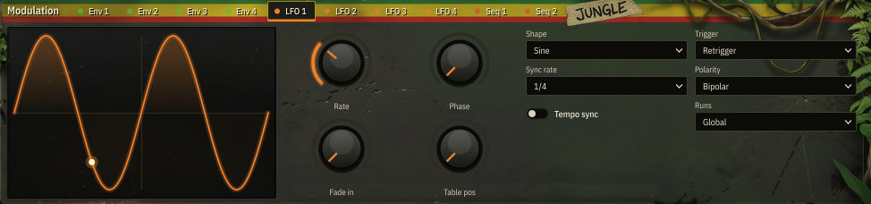

XONOVA has four LFOs (low-frequency oscillators), **LFO 1** to **LFO 4**: repeating shapes for wobbles,
vibrato, sweeps and rhythmic movement.

## Controls

| Control | Options / range | What it does |
|---|---|---|
| **Shape** | 9 shapes (below) | The waveform |
| **Rate** | 0.01 – 100 Hz | Speed when not synced |
| **Tempo sync** | On / off | Lock the speed to your DAW's tempo |
| **Sync rate** | 8/1 to 1/64, with dotted (.) and triplet (T) values | Speed when synced |
| **Phase** | 0 – 360° | Where in the cycle it starts |
| **Trigger** | Retrigger, Free, One-shot | See below |
| **Fade in** | 0 – 10 s | Fades the LFO in after each note starts – delayed vibrato |
| **Polarity** | Bipolar, Unipolar | Swing both ways around the knob (−1…1) or only upward (0…1) |
| **Runs** | Per Voice, Global | See below |
| **Table pos** | 0 – 100 % | Morph position for the **Wavetable** shape |

## Shapes

| Shape | |
|---|---|
| **Sine** | Smooth and round |
| **Triangle** | Linear up and down |
| **Saw Up** / **Saw Down** | Ramps – rising or falling |
| **Square** | Switches between two values |
| **Sample & Hold** | A new random value each cycle, held – the classic random stepping |
| **Smooth Random** | Random values with smooth glides between them – organic drift |
| **Wavetable** | Morphs sine → triangle → saw → square as **Table pos** moves. Modulate Table pos for a shape-changing LFO. |
| **Custom** | Your own drawn shape (below) |

## Trigger modes

| Trigger | Behaviour |
|---|---|
| **Retrigger** | Each note restarts the cycle at **Phase**. Every note wobbles the same way. |
| **Free** | Keeps running regardless of notes. When synced and your DAW is playing, it follows the song position, so it stays on the beat. |
| **One-shot** | Runs a single cycle from each note, then holds its last value – an extra envelope. |

Every mode restarts the **fade-in** on each note.

## Per voice or global

- **Per Voice**: each note has its own LFO. With Retrigger, every note starts its own cycle – chords stay
  coherent and each note moves on its own.
- **Global**: one LFO shared by all notes – the whole chord wobbles together, like a hardware LFO.

## Drawing a custom shape

Set **Shape** to **Custom** and the display shows one cycle you can draw:

| Action | Result |
|---|---|
| Click an empty spot | Add a point (up to 32) |
| Drag a point | Move it |
| Double-click or right-click a point | Remove it |
| **Alt-drag** a segment | Bend the curve between two points |

:::tip[Classic wobble]
LFO 1 → Filter 1 Cutoff, **Sine**, **Tempo sync** on, **Sync rate** `1/8`, **Retrigger**. Then right-click the
Cutoff knob and set that routing's **Scale by** to a macro: now the macro dials the wobble in and out.
:::
