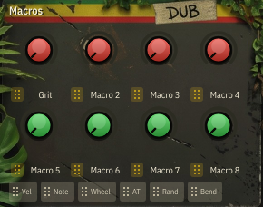

**Macros** are eight knobs that don't do anything on their own: you route them to as many parameters as you
like, so a single turn changes a whole sound. Factory presets use them for the most useful moves, with
names like *Grit*, *Vowel* or *Formant*.

## Using macros

- **Route:** drag a macro's **handle** (the dotted grip next to its name) onto any knob. Repeat for as many
  targets as you want, and Alt-drag each target to set how far it moves.
- **Rename:** double-click the macro's label and type a name. Names are saved with the preset.
- **Play:** turn the macro knob. It's a normal parameter, so your DAW can automate it and you can map it to a
  hardware knob with [MIDI learn](/xonova-docs/midi/midi-learn/).

## Macros as scale sources

A macro can also control **how much** another routing does: right-click a modulated knob, choose the
routing, then **Scale by → Macro**. Now the LFO wobble (for example) only kicks in as you turn the macro
up. See [Modulation matrix](/xonova-docs/modulation/matrix/#scale-by).

:::tip[Designing good macros]
- Route one macro to several parameters that belong together: *Growl* might open the cutoff, add drive and
  bring in the mod osc's phase amount.
- Use negative amounts so some things go down while others go up.
- Keep the useful range across the whole turn: a macro that only does something in the last 10 % is hard to
  perform with.
:::
