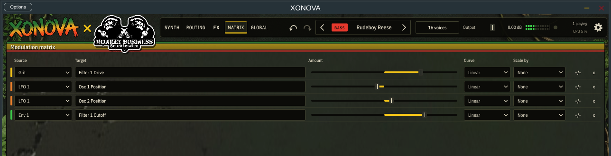
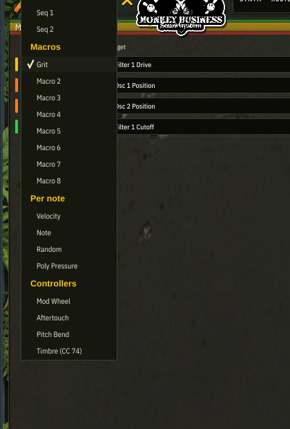

The [Matrix page](/xonova-docs/pages/matrix/) shows every routing in the patch as a row. Routings you make
by dragging appear here automatically, and anything you change here shows on the knobs.

## Columns

### Source

Any modulation source, grouped into Envelopes, LFOs, Step sequencers, Macros (shown with their names),
Per note and Controllers.

### Target

Click the target to choose from **every modulatable parameter**, grouped by section: Voice, Osc 1–3, Mod
Osc, Noise, Feedback, Filter 1–2, Filters, Insert 1–2, FX 1–8, Output, and the modulators themselves
(Env 1–4, LFO 1–4, Step Seq 1–2). That last group means you can modulate modulators – an envelope on an
LFO's rate, or a macro on an envelope's decay.

### Amount

The depth, from −100 % to +100 %. Left of centre is negative. Double-click to reset.

### Curve

Reshapes the source before it's applied:

| Curve | Effect |
|---|---|
| **Linear** | As is |
| **Exponential** | Slow at first, fast at the end – more control over small amounts |
| **Logarithmic** | Fast at first, then levels off |
| **S-curve** | Gentle at both ends, steep in the middle |
| **Stepped** | Quantised into steps – for stepped pitch or stuttering movement |

### Scale by

Multiplies the routing's depth by a second source. Typical uses:

- **Macro** – dial a whole modulation in and out with one knob.
- **Mod Wheel** – modulation only when you push the wheel (vibrato, wobble).
- **Velocity** – harder notes get more modulation.
- **An envelope** – modulation that fades in or out over each note.

### +/− (bipolar)

Most sources run from 0 to 1, so they only push a parameter one way. **+/−** recentres such a source to swing
from −1 to 1 around the knob's position. Turn it on for an envelope or macro that should move a value both
up and down.

### x

Removes the routing.

## Adding routings

Click **Add routing** at the bottom, then pick a source and a target. There's room for **64** routings
per patch.
