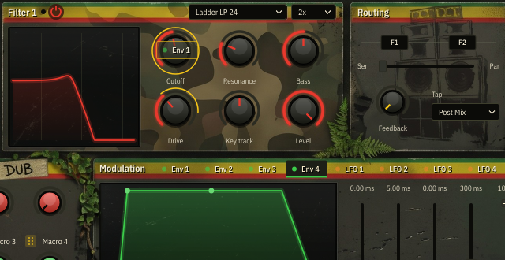
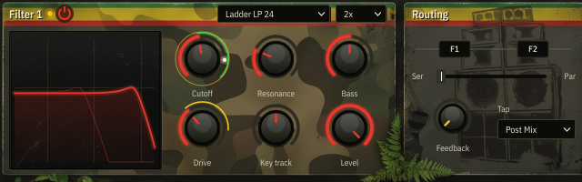
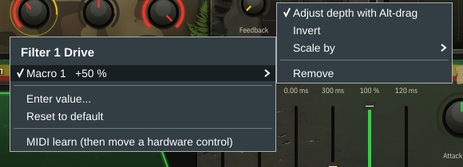

Modulation makes a sound move: an envelope opens a filter on every note, an LFO sweeps a wavetable, the
mod wheel adds vibrato. In XONOVA you make a routing by **dragging a source onto a knob**.

## Sources

| Source | Count | Range | Per voice? |
|---|---|---|---|
| [Envelopes](/xonova-docs/modulation/envelopes/) | Env 1–4 | 0 → 1 | Yes |
| [LFOs](/xonova-docs/modulation/lfos/) | LFO 1–4 | −1 → 1 (bipolar) or 0 → 1 (unipolar) | Per voice or global |
| [Step sequencers](/xonova-docs/modulation/step-sequencers/) | Seq 1–2 | 0 → 1 | Yes |
| [Macros](/xonova-docs/modulation/macros/) | Macro 1–8 | 0 → 1 | No (one knob) |
| [Velocity, Note, Random, Poly Pressure](/xonova-docs/modulation/performance-sources/) | | see page | Yes |
| [Mod Wheel, Aftertouch, Pitch Bend, Timbre (CC 74)](/xonova-docs/modulation/performance-sources/) | | see page | No |

**Env 4** drives the amplifier by default (you can pick another on the
[Amp tab](/xonova-docs/pages/synth/#the-amp-tab)), so Env 1–3 are free for anything.

## Making a routing

**Drag a source onto a knob.** What you can drag:

- a **tab** in the Modulation panel: **Env 1**, **LFO 2**, **Seq 1**…
- a macro's **handle** – the dotted grip next to its name,
- one of the **chips** under the macros: **Vel**, **Note**, **Wheel**, **AT**, **Rand**, **Bend**.

Drop it on a knob and the routing is made. The knob gets a **ring** in the source's colour showing the
range the source sweeps, and while notes play a bright dot shows where the value really is.

A knob can have several routings from different sources; each gets its own ring.

## Setting the depth

**Alt-drag** the knob to change the depth of its active routing. Drag up for more, down for less, and
through zero for a negative (inverted) amount. Normal dragging still moves the knob's own value.

## The routing menu

Right-click a modulated knob. Each routing is listed with its amount; hover it for:

| Item | What it does |
|---|---|
| **Adjust depth with Alt-drag** | Makes this the routing Alt-drag changes (when a knob has several). |
| **Invert** | Flips the routing's direction. |
| **Scale by** | Multiplies the depth by another source – a macro, the mod wheel, velocity… The routing only does something as far as that source is turned up. |
| **Remove** | Deletes the routing. |

## The matrix

Every routing also appears on the [Matrix page](/xonova-docs/modulation/matrix/), with extra controls:
response curves, bipolar mode and targets that have no knob on screen. XONOVA has room for **64
routings** per patch.

## Per voice vs global

Most sources run **per voice**: each note has its own envelopes, its own velocity, its own random value. So
an envelope on the cutoff opens the filter separately for every note. **Global** sources – macros, the mod
wheel, aftertouch, pitch bend, timbre and LFOs set to *Global* – are the same for all notes.

:::tip
Modulation is additive: the knob sets the starting point, the routing moves it from there. With the cutoff
knob at 300 Hz and an envelope routing of +60 %, each note opens from 300 Hz upward.
:::
