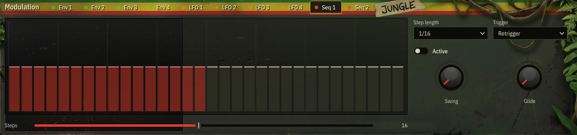

XONOVA has two step sequencers, **Seq 1** and **Seq 2**. Each plays a rhythmic pattern of values that you
draw, locked to your DAW's tempo. Use them for gated pads, rhythmic filter patterns, stepped pitch or
wavetable sequences.

## Controls

| Control | Options / range | What it does |
|---|---|---|
| **Active** | On / off | Runs the sequencer. It's off by default, so switch it on. |
| **Step length** | 8/1 to 1/64, with dotted and triplet values (default 1/16) | How long each step lasts |
| **Steps** | 1 – 32 (default 16) | Pattern length. Steps past the length are dimmed. |
| **Swing** | 0 – 100 % | Delays every second step. At 100 % a pair of steps splits 3:1. |
| **Glide** | 0 – 100 % | Slides smoothly from each step's value to the next instead of jumping |
| **Trigger** | Retrigger, Free | **Retrigger** restarts the pattern on each note. **Free** follows your DAW's song position. |

## Drawing steps

- **Click or drag** across the grid to draw step values (bottom = 0, top = full).
- **Double-click** a step to reset it to the middle.

While notes play, the current step is lit.

## Ideas

- **Trance gate:** Seq 1 → Osc levels (or the amp via a negative routing), steps alternating high and low.
- **Rhythmic filter:** Seq 1 → Filter 1 Cutoff, with a little **Glide** for a squelchy acid line.
- **Stepped melodies:** Seq 1 → Osc 1 **Semi**, with a matrix **Stepped** curve, for arpeggio-like patterns.
- **Wavetable rhythm:** Seq 2 → Osc 2 **Position** with a table like *Vowels* for talking patterns.
