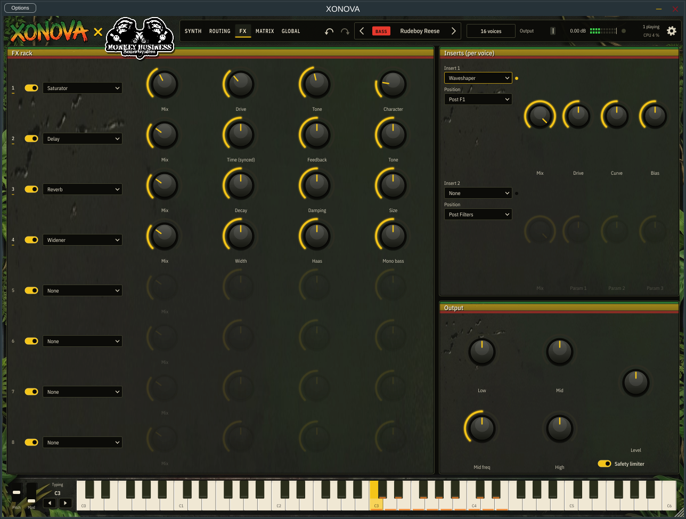

The **FX** page holds everything that processes the sound after (and, for the inserts, inside) the
voices.

| Panel | What it is | See |
|---|---|---|
| **FX rack** (left) | Eight effect slots in series, after all voices are mixed | [FX rack](/xonova-docs/effects/fx-rack/) |
| **Inserts (per voice)** (top right) | Two effects inside each voice, before or after the filters | [Inserts](/xonova-docs/effects/inserts/) |
| **Output** (bottom right) | Three-band EQ, level and safety limiter | [Output](/xonova-docs/effects/output/) |

Each FX slot and insert has a type selector, a **Mix** knob and three parameters whose names change with
the type. Unused slots (type **None**) are drawn dimmed.

:::tip
Inserts work **per voice**: a bitcrusher on a chord crushes each note separately, which sounds cleaner than
crushing the whole chord. FX rack effects work on the **mix**: a reverb on a chord is one reverb.
:::
