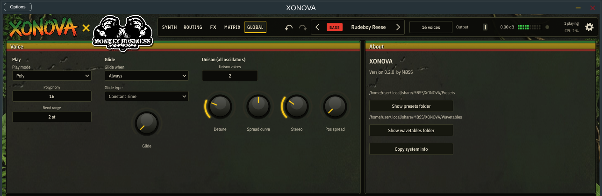

The **Global** page holds the voice settings that apply to the whole patch, and the **About** panel.

## Voice

| Group | Controls | See |
|---|---|---|
| **Play** | Play mode, Polyphony, Bend range | [Unison, voices and glide](/xonova-docs/sound/unison-and-voices/) |
| **Glide** | Glide when, Glide type, Glide time | [Glide](/xonova-docs/sound/unison-and-voices/#glide) |
| **Unison (all oscillators)** | Unison voices, Detune, Spread curve, Stereo, Pos spread | [Unison](/xonova-docs/sound/unison-and-voices/#unison) |

## About

- The **version** of XONOVA you're running.
- Where your **presets** and **wavetables** folders are, with buttons to open them.
- **Copy system info** – copies the version, plugin format, host, operating system and audio settings to the
  clipboard. Paste it into any bug report: see [Reporting problems](/xonova-docs/help/reporting-problems/).
