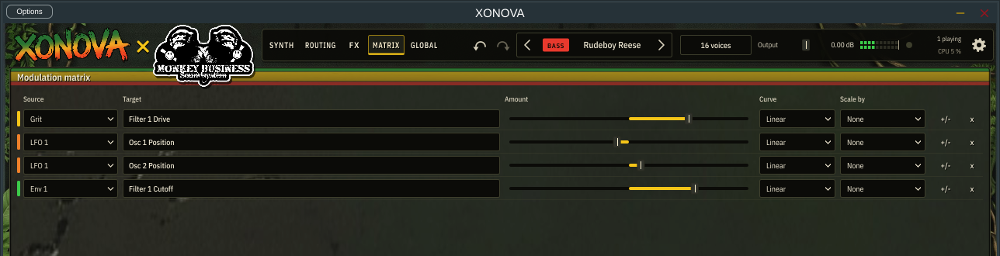

The **Matrix** page lists every modulation routing in the patch – whether you made it by dragging or here.
It's the place to fine-tune routings, see what a preset does, and add routings to targets that don't have a
knob on screen.

For the full details, see [Modulation matrix](/xonova-docs/modulation/matrix/).

## At a glance

| Column | What it does |
|---|---|
| Colour bar | The source's colour |
| **Source** | The modulation source |
| **Target** | The parameter it moves; click to choose from a menu of every modulatable parameter |
| **Amount** | Depth and direction (left of centre is negative) |
| **Curve** | Linear, Exponential, Logarithmic, S-curve or Stepped |
| **Scale by** | Another source that scales the depth, for example a macro or the mod wheel |
| **+/−** | Makes a 0…1 source swing both ways around the centre |
| **x** | Removes the routing |

**Add routing** at the bottom adds a new row. XONOVA has room for 64 routings per patch.
