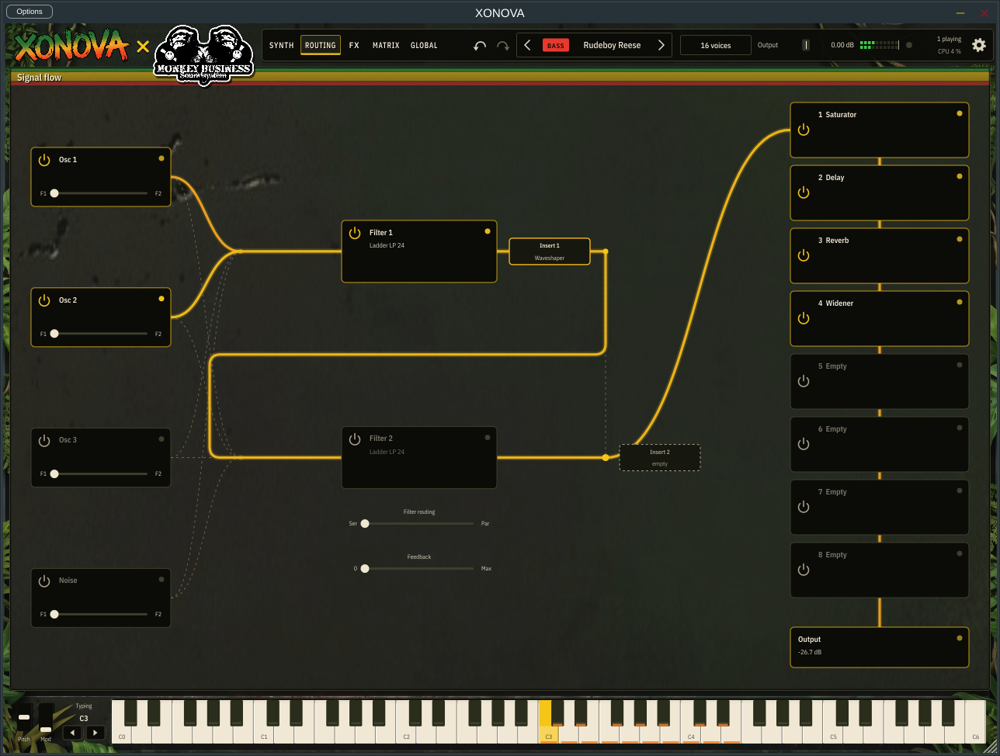

The **Routing** page draws the whole signal path of XONOVA as a diagram, from the sources on the left to
the output at the bottom right. It isn't just a picture: you can edit almost everything on it directly.



## Reading the diagram

```
Osc 1–3, Noise ──(F1/F2 balance)──▶ Filter 1 ─┬─(serial)───▶ Filter 2 ──▶ mix ──▶ FX 1…8 ──▶ Output
                                               └─(parallel)──────────────────▲
```

- **Wires** are drawn by how much signal they carry: a source sent fully to Filter 1 has a solid wire to
  Filter 1 and a faint dashed one to Filter 2.
- While you play, wires and blocks **glow** with the live signal level, and each block's light shows
  activity.
- **Insert 1** and **Insert 2** sit on the wires at their current positions. An empty insert is drawn
  dashed.
- The **FX rack** runs top to bottom on the right, ending in the **Output** block with the current level.

## Editing

| Do this | To |
|---|---|
| Drag a source's **F1 – F2** handle | Balance it between Filter 1 and Filter 2 |
| Drag the **Filter routing** handle (Ser – Par) | Blend from serial to parallel |
| Drag the **Feedback** handle | Set the filter feedback amount |
| Click a **power symbol** | Switch a source, filter or FX slot on or off |
| Drag an **insert block** | Move it to one of its four positions: before Filter 1, after Filter 1, before Filter 2 or after both filters |
| Drag an **FX slot** up or down | Reorder the effects chain |
| Double-click a handle | Reset it |

Everything you do here is the same as on the other pages: it's undoable, and the host sees it as
parameter changes, so it can be automated.

## Why use it

- To **see** why something sounds the way it does: which filter a source really goes through, where an
  insert sits, what order the effects run in.
- To **find silence**: follow the glow to the point where the signal stops.
- To **try routings fast**: drag an insert from after Filter 1 to after both filters and hear the difference
  immediately.

See [Filter routing and feedback](/xonova-docs/filters/routing/), [Inserts](/xonova-docs/effects/inserts/) and
[FX rack](/xonova-docs/effects/fx-rack/) for what each part does.
