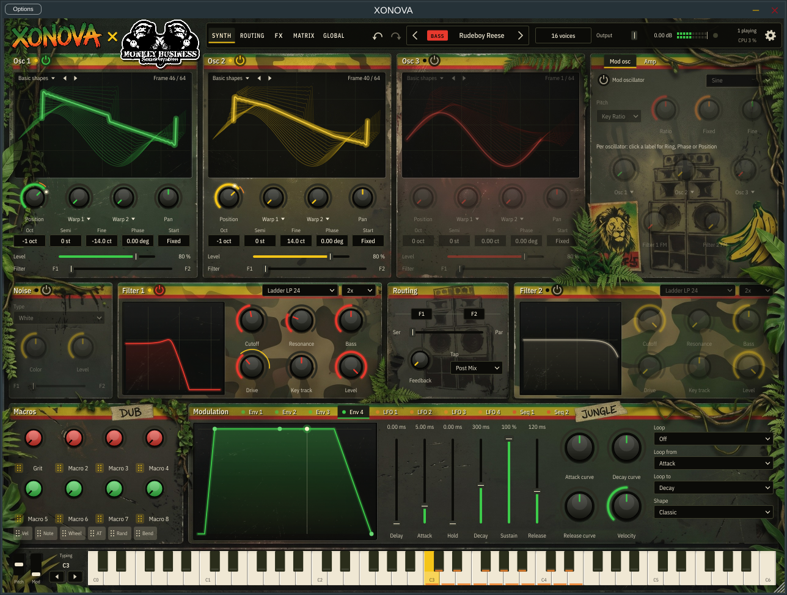
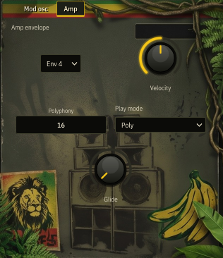

The **Synth** page is where you design sounds. It holds every sound source, both filters and all the
modulation sources in one view.

## Layout

**Top row – sound sources**

| Panel | See |
|---|---|
| **Osc 1**, **Osc 2**, **Osc 3** | [Wavetable oscillators](/xonova-docs/sound/oscillators/) |
| **Mod osc / Amp** (tabs) | [Mod oscillator](/xonova-docs/sound/mod-oscillator/) and the amp settings below |

**Middle row – noise and filters**

| Panel | See |
|---|---|
| **Noise** | [Noise](/xonova-docs/sound/noise/) |
| **Filter 1**, **Filter 2** | [Filters](/xonova-docs/filters/filters/) |
| **Routing** | [Filter routing and feedback](/xonova-docs/filters/routing/) |

**Bottom row – modulation**

| Panel | See |
|---|---|
| **Macros** and the source chips (Vel, Note, Wheel, AT, Rand, Bend) | [Macros](/xonova-docs/modulation/macros/), [Performance sources](/xonova-docs/modulation/performance-sources/) |
| **Modulation** (tabs Env 1–4, LFO 1–4, Seq 1–2) | [Envelopes](/xonova-docs/modulation/envelopes/), [LFOs](/xonova-docs/modulation/lfos/), [Step sequencers](/xonova-docs/modulation/step-sequencers/) |

## The Amp tab

Next to **Mod osc** at the top right, the **Amp** tab collects the settings that shape every note's volume
and how notes are played:

| Control | What it does |
|---|---|
| **Amp envelope** | Which envelope shapes each note's volume. Env 4 by default; any of the four can do the job. |
| **Velocity** | How much the amp envelope reacts to how hard you play (the selected envelope's velocity sensitivity). |
| **Polyphony** | Same as in the header. |
| **Play mode** | Poly, Mono or Legato. |
| **Glide** | Glide time. |

The full set of voice settings is on the [Global page](/xonova-docs/pages/global/).

## Signal lights

The small light next to each section title shows that signal is passing through it. If you hear nothing,
follow the lights to see where the sound stops.

## Modulation rings

Knobs with modulation show a coloured ring in the colour of their source, and a bright dot for the live
value while notes play. Drag any modulation tab, macro handle or source chip onto a knob to add a routing.
See [Modulation overview](/xonova-docs/modulation/overview/).
