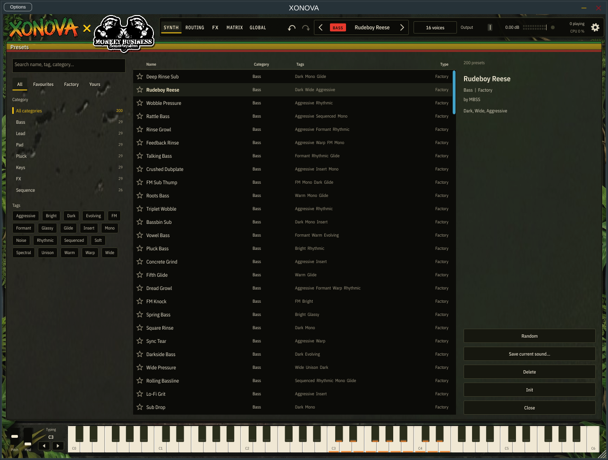

Click the **preset name** in the header to open the browser. The ◂ ▸ arrows next to the name step through
presets without opening it.

## The factory library

XONOVA comes with **200 factory presets** by Monkey Business Soundsystem in seven categories:

| Category | Presets |
|---|---|
| Bass | 29 |
| Lead | 29 |
| Pad | 29 |
| Pluck | 29 |
| Keys | 29 |
| FX | 29 |
| Sequence | 26 |

Factory presets are loudness-matched, so you can step through them without riding the volume.

## Finding presets

- **Search** – type in the box at the top left (<kbd>Ctrl</kbd>/<kbd>Cmd</kbd>+<kbd>F</kbd> jumps there).
  It searches names, categories, tags, authors and comments; every word you type has to match.
- **Origin** – **All**, **Favourites**, **Factory** or **Yours**.
- **Category** – click one to filter; the numbers show how many presets match.
- **Tags** – click tags such as *Dark*, *Glide*, *FM* or *Unison* to narrow down.
- **Sort** – click **Name** or **Category** above the list.

## Auditioning

- **Click** a preset or use the <kbd>↑</kbd> <kbd>↓</kbd> arrow keys: it loads immediately, so you can play
  while you browse.
- <kbd>Enter</kbd> or a **double-click** loads it and closes the browser.
- **Random** loads a random preset from the current list – handy with a category or tag selected.
- <kbd>Escape</kbd> clears the search; press it again to close the browser. **Close** does the same.

The panel on the right shows the selected preset's name, category, type, author, tags and comment.

## Managing presets

| Action | How |
|---|---|
| Favourite | Click the ☆ star, or right-click → **Add to favourites**. Favourites are listed under **Favourites**. |
| Rename or delete *your* preset | Right-click → **Rename…** or **Delete…**, or select it and click **Delete** |
| Show the file | Right-click → **Show file** (your presets) |
| Start from scratch | **Init** |
| Save | **Save current sound…** – see [Saving presets](/xonova-docs/presets/saving/) |

Factory presets can't be renamed or deleted, but you can save a changed copy as your own.

Loading a preset is one undo step – <kbd>Ctrl</kbd>/<kbd>Cmd</kbd>+<kbd>Z</kbd> brings back the sound you had
before.
