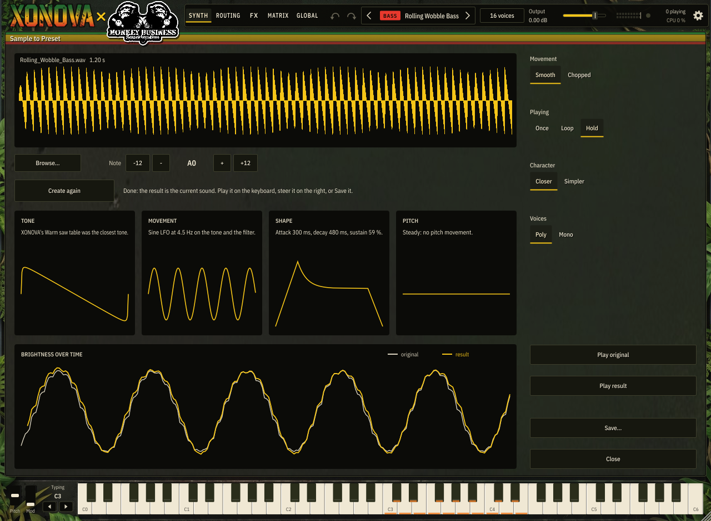

**Sample to Preset** turns a short sound into a XONOVA patch. It is not a sampler: XONOVA measures the sound
and rebuilds it with its own synthesis. The tone comes from a recipe of the sound's harmonics (or the closest
factory wavetable), and every movement comes from XONOVA's own LFOs, envelopes and filter. A wobble becomes an
LFO whose rate you can change; a pitch drop becomes a pitch envelope.

Open the [preset browser](/xonova-docs/presets/browser/) and click **Sample to Preset…**:

## Step by step

1. **Load a sound.** Drop a WAV, AIFF or FLAC file on the panel, or click **Browse…**. The first 10 seconds
   are used. One note works best: a bass hit, a stab, a pluck.
2. **Check the note.** The panel shows the note it detected. If it is wrong, correct it with **−** / **+** (a
   semitone) or **−12** / **+12** (an octave). A note in the file name (`Bass_C#_05.wav`) helps.
3. **Create.** XONOVA builds the patch in a few seconds; **Cancel** (or Escape) stops it. The result becomes
   the current sound, and undo takes it back.
4. **Compare.** **Play original** (Shift+Space) and **Play result** (Space) play both at the same loudness.
   Your keyboard and the computer keyboard's note keys play the result too.
5. **Steer.** Each change re-tunes the result in a few seconds:

   | Control | Choices |
   |---|---|
   | **Movement** | **Smooth**, or **Chopped** (a square LFO that also chops the level) |
   | **Playing** | **Once** (ends with the sound), **Loop** (the movement repeats) or **Hold** (sustains while held) |
   | **Character** | **Closer**, or **Simpler** (one oscillator, at most three modulations) |
   | **Voices** | **Poly** or **Mono** |

6. **Save…** stores it as your preset. The tone recipe is saved inside the preset, so it plays anywhere.

## What the panel shows

Under the waveform, four cards say what XONOVA built: the **tone** (the recipe or the factory table, drawn as
one cycle), the **movement** (the LFO and what it moves), the **shape** of the volume (attack, decay,
sustain) and the **pitch** (a drop or rise into the note). **Brightness over time** draws the original's
brightness and the result's, one over the other: the closer the two curves, the closer the sound.

## Tips

- **Short, single notes** give the best results. Chords, drum loops and noise get a "rough result" notice.
- After Create, the patch is a normal XONOVA sound: open the pages and change anything, then **Save…**.
- **Simpler** gives a patch that is easier to tweak by hand; **Closer** follows the sound more tightly.
