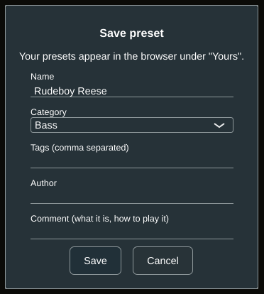

## Saving

Open the [preset browser](/xonova-docs/presets/browser/) and click **Save current sound…**:

| Field | Used for |
|---|---|
| **Name** | The preset's name |
| **Category** | Bass, Lead, Pad, Pluck, Keys, FX or Sequence |
| **Tags** | Comma-separated, for example `reese, dark, glide`. Shown in the list and found by the search. |
| **Author** | You. Shown in the browser and searchable. |
| **Comment** | What it is and how to play it, for example “mod wheel opens the growl”. Shown in the browser and searchable. |

Your presets appear in the browser under **Yours**, and in the header's preset menu under **Your presets**.

## What a preset contains

Everything about the sound: every parameter, all modulation routings, curves and sequencer steps, macro
names, the wavetables (including [imported ones](/xonova-docs/wavetables/import/), embedded in the file) and
the FX order.

What it **doesn't** contain:

- your [MIDI learn](/xonova-docs/midi/midi-learn/) assignments – they stay with you, not with the sound,
- the [settings](/xonova-docs/interface/settings/) such as interface size.

## Where preset files live

| System | Folder |
|---|---|
| Linux | `~/.local/share/MBSS/XONOVA/Presets` |
| Windows | `%APPDATA%\MBSS\XONOVA\Presets` |
| macOS | `~/Library/Application Support/MBSS/XONOVA/Presets` |

Open it with **gear → Show presets folder**. Each preset is one `.xnpreset` file, in a subfolder named after
its category (for example `Presets/Bass/My Reese.xnpreset`).

## Sharing

To share a preset, send its `.xnpreset` file. The receiver drops it into the matching category folder in
their own presets folder and it appears under **Yours**. Because wavetables are embedded, nothing else needs
to be sent.

:::tip
Back up your presets folder along with your projects – it's all your sound design in one place.
:::
