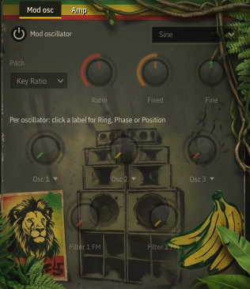

The **Mod osc** is a simple oscillator that you don't hear directly: it modulates the three wavetable
oscillators and the two filters **at audio rate**. That's where metallic, bell-like, FM and growling tones
come from. It shares a panel with the **Amp** tab at the top right of the Synth page.

## Shape and pitch

| Control | Options / range |
|---|---|
| **Power** | On / off (off by default) |
| **Shape** | Sine, Triangle, Saw, Square |
| **Pitch** | **Key Ratio** – follows the note you play, as a ratio of its frequency. **Fixed** – stays at one frequency. |
| **Ratio** | 0.125x to 16x (Key Ratio mode). 1x is the note's own pitch, 2x an octave up. |
| **Fixed** | 0.1 Hz to 5 kHz (Fixed mode). |
| **Fine** | ±100 cents |

Whole-number ratios (1, 2, 3…) give harmonic, musical results. Odd ratios like 1.41 or 3.7 give clangorous,
bell-like ones. A low Fixed frequency gives slow wobbles; a high one, inharmonic noise.

## Per oscillator: Ring, Phase or Position

Under the pitch controls there's one knob for each of **Osc 1**, **Osc 2** and **Osc 3**. Click the label
under a knob (**Osc 1 ▾**) to choose what the mod oscillator does to that oscillator; the knob sets the
amount.

| Mode | Effect |
|---|---|
| **Off** | No modulation |
| **Ring** | Ring modulation: multiplies the oscillator by the mod osc. Adds sum and difference tones; at high amounts the original pitch can disappear. |
| **Phase** | Phase modulation, the technique behind classic “FM” synths. Adds sidebands and bright, glassy or metallic harmonics. |
| **Position** | Moves the wavetable Position at audio rate. A grittier, more table-dependent kind of FM. |

## Filter FM

**Filter 1 FM** and **Filter 2 FM** modulate each filter's cutoff with the mod oscillator. Small amounts
add bite and buzz; large amounts get aggressive and noisy, especially with resonance.

:::tip
For a growl: Key Ratio at **1x** or **0.5x**, Phase mode on Osc 1, then modulate the Phase amount with an
LFO or a macro.
:::
