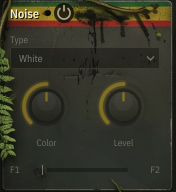

The **Noise** source adds air, breath, grit and percussive transients. It's per voice, so it follows your
envelopes just like the oscillators, and it's routed to the filters the same way.

| Control | What it does |
|---|---|
| **Power** | On / off (off by default) |
| **Type** | The kind of noise (below) |
| **Color** | Shapes the noise; what it does depends on the type. 50 % is neutral. |
| **Level** | Volume |
| **F1 – F2** | Balances the noise between Filter 1 and Filter 2 |

## Types

| Type | Sound | What Color does |
|---|---|---|
| **White** | Bright, even hiss | Below 50 % darkens it, above thins it out |
| **Pink** | Softer, warmer hiss (−3 dB per octave) | Same darker / thinner tilt |
| **Filtered** | A resonant band of noise | Moves the band from about 100 Hz up to about 18 kHz – a whistle or wind you can sweep |
| **Crackle** | Random clicks, like vinyl | How dense the clicks are |

:::tip
A short burst of white noise shaped by a fast envelope on its **Level** gives a pluck or a stab extra
attack. Crackle at a low level under a pad adds dusty, sampled character.
:::
