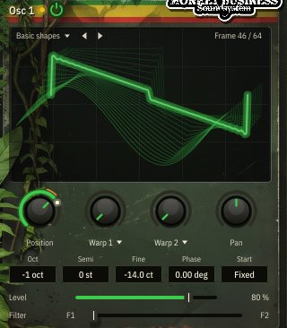

XONOVA has three wavetable oscillators per voice, **Osc 1**, **Osc 2** and **Osc 3**. Each has its own
colour (green, yellow, red) that carries through to its displays and modulation rings. Only Osc 1 is on in
a new patch; click the **power button** next to a title to switch an oscillator on or off.

## Wavetables and Position

A **wavetable** is a series of single-cycle waveforms called *frames*. Most factory tables have 64 frames.
**Position** moves through them: at 0 % you hear the first frame, at 100 % the last, and in between
XONOVA blends smoothly from one frame to the next.

- **Choosing a table:** click the table name at the top left of the display. The menu lists the
  [40 factory tables](/xonova-docs/wavetables/factory/) by category, your **User folder**, and
  **Import WAV file…** for [your own tables](/xonova-docs/wavetables/import/).
- **Stepping:** the ◂ ▸ arrows next to the name step to the previous and next table.
- **Frame counter:** the top right of the display shows the frame you're on, for example *Frame 33 / 64*.

The display draws the table as stacked frames, with the current one highlighted. While notes play it shows
the frame the newest note is actually on, including modulation.

:::tip
Position is the most rewarding thing to modulate. An envelope on Position makes each note's timbre evolve;
an LFO makes it sweep; velocity makes harder notes brighter.
:::

## Warp 1 and Warp 2

Two warp stages reshape the wave **after** the table, in series. Each has a **mode** (click the **Warp 1 ▾**
or **Warp 2 ▾** label to choose) and an **amount** (the knob). See [Warp modes](/xonova-docs/sound/warp-modes/)
for what each mode does.

## Pitch

| Control | Range | What it does |
|---|---|---|
| **Oct** | −4 to +4 oct | Octave transpose |
| **Semi** | −12 to +12 st | Semitone transpose |
| **Fine** | −100 to +100 ct | Fine tune in cents |

Detuning two oscillators a few cents apart (or one an octave or a fifth away) is the fastest way to a big
sound. The **Pitch Bend Range** on the [Global page](/xonova-docs/pages/global/) applies to all of them.

## Phase and Start

**Start** sets where each note's wave begins:

| Start | Behaviour |
|---|---|
| **Free** | The oscillator keeps running between notes; each note picks up wherever it is. Lively, a little different every time. |
| **Fixed** | Every note starts at the **Phase** angle (0–360°). Punchy and consistent – the default, and the best choice for basses and plucks. |
| **Random** | Every note starts at a random phase. |

## Level, Pan and Filter

| Control | What it does |
|---|---|
| **Level** | The oscillator's volume (default 80 %). |
| **Pan** | Stereo position, left to right. |
| **Filter** | Balances the oscillator between **F1** (Filter 1) and **F2** (Filter 2). All the way left sends it only to Filter 1, all the way right only to Filter 2. See [Filter routing](/xonova-docs/filters/routing/). |

## Unison

Each oscillator can be stacked into up to 8 detuned copies per voice. Unison is set for all oscillators at
once on the Global page: see [Unison and voices](/xonova-docs/sound/unison-and-voices/).

## Audio-rate modulation

The [mod oscillator](/xonova-docs/sound/mod-oscillator/) can ring-modulate, phase-modulate or move the
Position of each oscillator at audio rate, for metallic, FM-style and growling tones.
