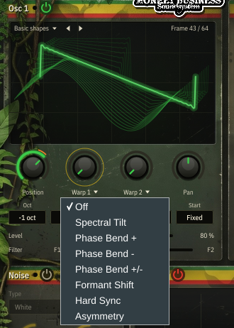

Every oscillator has two warp stages, **Warp 1** and **Warp 2**. Each reshapes the waveform after it's read
from the wavetable. Click a warp's label (**Warp 1 ▾**) to choose its mode, and turn its knob to set the
amount. At amount 0 a warp does nothing.

## The modes

| Mode | Type | What it does | Try it for |
|---|---|---|---|
| **Off** | – | No warp. | |
| **Phase Bend +** | Phase | Squeezes the wave around its start and end, so the edges of the cycle play faster. | Brighter, more nasal tones. |
| **Phase Bend −** | Phase | Squeezes the wave around its middle. | Hollow, vocal movement. |
| **Phase Bend +/−** | Phase | Squeezes it around both. | Complex, buzzy timbres. |
| **Asymmetry** | Phase | Squeezes the first half of the cycle and stretches the second half. | Pulse-width-like movement on any table. |
| **Hard Sync** | Phase | Restarts the wave up to 16 times per cycle (1x–16x as the amount rises). | Classic sync leads and screaming sweeps. |
| **Spectral Tilt** | Spectral | Tilts the harmonics: more amount boosts the highs (about +6 dB per octave per half turn). | Brightening without a filter. |
| **Formant Shift** | Spectral | Moves the spectral envelope up by up to two octaves while the pitch stays put. | Vowel and talking effects. |

### Phase warps vs spectral warps

- **Phase warps** (the bends, asymmetry, hard sync) change *how fast* the wave is read through its cycle.
  They're smooth and stay clean (band-limited) even when modulated quickly; XONOVA runs a phase-warped
  oscillator at twice the sample rate internally to keep aliasing out of the audible range.
- **Spectral warps** (tilt and formant shift) rebuild the frame from its harmonics. They keep the loudness
  of the original wave. They don't follow the mod oscillator's audio-rate *Position* modulation.

### Order

The two stages run in series, and spectral stages always act on the frame first, then the phase stages.
Combining one of each – for example **Formant Shift** on Warp 1 and **Hard Sync** on Warp 2 – gives you
both kinds of movement at once.

:::tip
Warp amounts are great modulation targets. Put an envelope on Hard Sync for a sync sweep on every note, or
an LFO on Formant Shift for a talking bass.
:::
